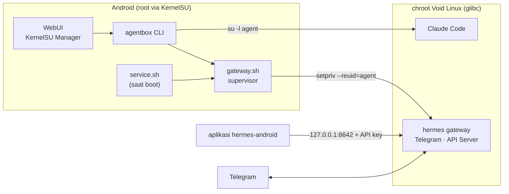

# agentbox

[English](README.md) · **Bahasa Indonesia**

**Claude Code dan Hermes Agent, berjalan langsung di HP Android Anda.**

agentbox adalah module [KernelSU](https://kernelsu.org) yang memasang Linux sungguhan (Void Linux, glibc) di
dalam HP, lalu menjalankan **[Claude Code](https://claude.com/claude-code)** dan
**[Hermes Agent](https://github.com/NousResearch/hermes-agent)** di sana sebagai user biasa yang terkurung
dengan aman. Satu kali setup, setelah itu agen AI Anda tinggal di saku, menyala sejak HP boot, dan bisa
diajak bicara lewat Telegram, terminal, atau aplikasi chat.


[](https://github.com/rjial/agentbox/releases)
[](LICENSE)

---

## Kenapa agentbox?

- **Bukan emulasi, bukan proot.** Chroot dengan root KernelSU: kecepatan native, glibc asli, sehingga
  binary resmi Claude Code dan Hermes jalan apa adanya, tanpa tambalan Termux.
- **Asisten yang selalu menyala.** Gateway Hermes (Telegram dan platform lain) diawasi supervisor
  sendiri: start otomatis saat boot, restart sendiri bila crash dengan backoff, log dirotasi.
- **Diatur dari HP, tanpa laptop.** WebUI di KernelSU Manager untuk status, gateway, terminal wizard,
  dan konfigurasi. Login akun Claude, pasang Hermes, atur Telegram, semuanya dari layar HP.
- **Aman secara default.** Agen tidak pernah jalan sebagai root, tidak punya sudo, dan rahasia tidak
  pernah muncul di log atau di argumen proses.
- **Satu CLI untuk semuanya.** `agentbox setup`, `doctor`, `shell`, `update`, `backup`, dan lainnya.
  WebUI hanya memanggil CLI yang sama, jadi perilakunya selalu konsisten.

## Fitur

### Setup sekali jalan, idempoten
`agentbox setup` mengunduh rootfs Void terbaru (checksum diverifikasi), memasang paket dasar, membuat
user `agent`, lalu memasang Claude Code dan Hermes lewat **installer resmi masing-masing**. Setiap
komponen punya penanda selesai: aman dijalankan ulang, dan bagian yang gagal bisa diulang sendiri.

```
rootfs → base → locale → user → claude → uv → hermes → gateway
```

### WebUI di KernelSU Manager
Empat halaman dengan navigasi bawah, tetap jalan **offline** (tanpa CDN):

| Halaman | Isi |
|---|---|
| **Status** | Komponen terpasang/belum, versi Claude Code & Hermes, ruang disk, langkah berikutnya |
| **Gateway** | Jalankan/hentikan/restart gateway, autostart saat boot, 200 baris log terakhir |
| **Terminal** | Terminal sungguhan (xterm.js) untuk wizard interaktif: login Claude, `hermes setup`, `hermes model`, `gateway setup`, install/pasang ulang Hermes |
| **Konfigurasi** | Provider & model Hermes, kunci tersamar dengan form edit, status kredensial yang dicek langsung ke Anthropic, kunci API untuk aplikasi chat |

Terminal WebUI **tidak membuka port jaringan apa pun**. Input/output lewat FIFO dan file milik root, dan
hanya perintah dari daftar tetap yang bisa dijalankan (tidak ada shell bebas).

### Login langganan Claude, dipakai berdua
Punya Claude Pro, Max, atau Team? Login sekali di Claude Code (`claude auth login`), lalu satu ketukan
**"Pakai Claude"** di halaman Konfigurasi (`agentbox config hermes-link-claude`) membuat Hermes memakai model
Claude lewat login yang sama, yang diperbarui otomatis. Provider Hermes lain dialihkan ke Anthropic (model
default `claude-sonnet-5`, `config.yaml` lama dicadangkan). Tidak perlu menyalin token yang bisa kedaluwarsa
atau terpotong.

`agentbox config auth-check` mengecek kredensial yang **benar-benar dipakai** langsung ke Anthropic
(gratis, tanpa membuat percakapan) dan menangkap kesalahan klasik seperti token OAuth yang tersimpan di
variabel API key.

### Chat dari aplikasi Android
Aktifkan **Gateway API Server** Hermes dengan satu tombol, lalu sambungkan klien chat
[hermes-android](https://github.com/rusty4444/hermes-android) ke `127.0.0.1:8642`. Kunci dibuat acak
(32 byte), hanya ditampilkan saat diminta, dan bisa diganti kapan saja.

### Diagnosis yang menjelaskan cara memperbaiki
`agentbox doctor` memeriksa arsitektur, rootfs, ruang disk, mount, DNS, HTTPS/sertifikat, locale, user,
akses internet sebagai `agent`, versi tool, kredensial, dan gateway. Setiap cek mencetak **OK / WARN /
FAIL** beserta perintah perbaikannya. `doctor --fix` hanya melakukan perbaikan yang aman.

## Cara kerja



- Rootfs disimpan di `/data/adb/agentbox/rootfs`, **di luar** folder module, sehingga tetap ada saat
  module diperbarui.
- Penyimpanan internal HP muncul sebagai `/sdcard` di dalam chroot, jadi proyek Anda bisa dikerjakan
  Claude Code langsung.

## Keamanan

Proyek ini dirancang dengan asumsi bahwa agen AI menjalankan kode, dan HP Anda berisi data penting.

- **Agen tidak pernah root.** `claude` dan `hermes` selalu berjalan sebagai user `agent` (uid tetap 8061),
  tanpa sudo dan tanpa grup `wheel`. Paket sistem hanya bisa dipasang lewat `agentbox install`.
- **UID dipilih dengan sengaja.** UID default 1000 bentrok dengan `AID_SYSTEM` Android, sedangkan UID
  ≥ 10000 diblokir netd. Agent memakai rentang yang tidak dipakai Android, plus grup jaringan yang
  dibutuhkan kernel Android.
- **Penghapusan tidak akan menyentuh penyimpanan Anda.** `reset` dan uninstall wajib melepas semua bind
  mount dan memverifikasinya lewat `/proc/mounts` sebelum menghapus apa pun, serta memvalidasi path.
- **Rahasia tidak pernah bocor ke log atau argv.** API key dibaca lewat stdin atau environment, ditampilkan
  hanya dalam bentuk tersamar (`sk-ant-…a1b2`), dan file konfigurasi ber-permission `600`.
- **Tanpa port terbuka yang tidak perlu.** Terminal WebUI tidak membuka port. API Server Hermes hanya di
  loopback dan wajib kunci. Dashboard web Hermes sengaja **tidak** diaktifkan, karena di loopback Android
  ia tanpa login dan bisa diambil alih aplikasi lain.

## Persyaratan

- HP Android **arm64** dengan **KernelSU** (dikembangkan dan diuji di KernelSU-Next).
- Metamodule untuk overlay `system/bin` (misalnya mountify). Tanpa itu, agentbox menulis perintah
  pendek ke Termux sebagai gantinya.
- Ruang kosong sekitar **3 GB** di `/data`, dan koneksi internet saat setup.
- Akun Claude (Pro/Max/Team) atau API key Anthropic untuk Claude Code. Hermes bisa memakai provider apa pun
  yang didukungnya.

## Instalasi

1. **Unduh zip module** dari [Releases](https://github.com/rjial/agentbox/releases): pilih
   `agentbox-vX.Y.Z-release.zip` (atau `-debug.zip` untuk log diagnosis lengkap). Cek integritasnya dengan
   `SHA256SUMS` di rilis yang sama.

   Atau build sendiri (bisa langsung di HP lewat Termux, atau di PC):
   ```sh
   git clone https://github.com/rjial/agentbox.git
   cd agentbox
   sh tools/build.sh release      # hasil: dist/agentbox-<versi>-release.zip
   ```
2. **Flash** zip itu lewat KernelSU Manager, lalu reboot.
3. **Setup**, pilih salah satu:
   - WebUI: KernelSU Manager → agentbox → **Terminal** → *setup (semua komponen)*, atau
   - Termux: `su -c agentbox setup`
4. **Login dan atur**:
   - Terminal → *login Claude Code*, lalu ketuk link, setujui di browser, dan tempel kodenya.
   - Konfigurasi → *Pakai login Claude Code* (bila Hermes memakai Anthropic), atau *hermes setup* untuk
     provider lain.
   - Terminal → *gateway setup* untuk Telegram. Gateway otomatis aktif saat boot.

## Pemakaian sehari-hari

```sh
claude                      # Claude Code di chroot, sebagai user agent
hermes                      # Hermes Agent
agentbox shell              # masuk chroot sebagai agent    (--root untuk perbaikan, --safe untuk rescue)
agentbox doctor             # diagnosis lengkap
agentbox config auth-check  # kredensial Anthropic yang dipakai, dicek ke API
agentbox service status     # status gateway             (start | stop | restart | log | autostart on|off)
agentbox update             # update rootfs, Claude Code, dan Hermes
agentbox backup             # arsipkan /home/agent
```

Perintah `claude`, `hermes`, dan `agentbox` bisa dipanggil langsung dari Termux; bila perlu, mereka naik ke
root lewat `su` lalu turun lagi ke user `agent`. Setiap perintah punya `--help`.

## Pengembangan

```sh
sh tools/build.sh release   # zip tanpa log debug
sh tools/build.sh debug     # zip dengan log debug: logs/debug.log, trace setup, installer Hermes --verbose
```

- Skrip sisi Android ditulis dalam **POSIX sh** dan wajib lolos `shellcheck -s sh` tanpa warning.
  Skrip di dalam chroot boleh bash (`shellcheck -s bash`).
- WebUI tanpa build step: HTML, CSS, dan JS biasa, dengan library di `webroot/vendor/` (xterm.js;
  Preact + htm pada halaman Konfigurasi).
- Catatan arsitektur, keputusan desain, dan hasil verifikasi lengkap ada di [`CLAUDE.md`](CLAUDE.md).

### Versi dan rilis

agentbox memakai [Semantic Versioning](https://semver.org). Versi hanya ditulis di `module.prop`
(`version=vMAJOR.MINOR.PATCH`, dengan `versionCode = MAJOR×10000 + MINOR×100 + PATCH` agar KernelSU selalu
mengenali versi yang lebih baru). Naikkan dengan:

```sh
sh tools/bump-version.sh patch     # atau minor | major | 1.2.0 | 1.3.0-rc.1
git commit -am "Rilis v0.1.1" && git push
```

Setiap push ke `main` yang mengubah versi menjalankan [GitHub Actions](.github/workflows/release.yml): lint
(shellcheck), validasi versi, build zip release + debug, lalu membuat **GitHub Release** `vX.Y.Z` lengkap dengan
`SHA256SUMS` dan catatan rilis otomatis. Versi pre-release (mis. `-rc.1`) ditandai sebagai *prerelease*.

### Update dari KernelSU Manager

`module.prop` berisi `updateJson`, sehingga KernelSU Manager memeriksa sendiri rilis stabil terbaru dan
menawarkan update lengkap dengan changelog-nya. Setiap rilis stabil menyertakan `update.json` dan `changelog.md`;
pre-release tidak ditawarkan sebagai update. Rootfs, konfigurasi, dan data di `/data/adb/agentbox` tidak
tersentuh saat module diperbarui.

## Status

agentbox dipakai dan diuji di satu perangkat (arm64, KernelSU-Next). Beberapa bagian masih berstatus
**prototipe**:

- Terminal WebUI: latensi dan keyboard virtual bergantung pada WebView KernelSU Manager di HP Anda.
- Halaman Konfigurasi adalah percontohan Preact; halaman lain masih JavaScript biasa.
- Aplikasi hermes-android adalah proyek pihak ketiga dan belum diuji menyeluruh bersama agentbox.

Laporan bug dan pull request sangat diterima.

## Kredit

- [Claude Code](https://claude.com/claude-code) oleh Anthropic. Binary-nya **tidak dibundel**; selalu diunduh
  dari installer resmi saat setup.
- [Hermes Agent](https://github.com/NousResearch/hermes-agent) oleh Nous Research, dipasang lewat installer
  resminya.
- [Void Linux](https://voidlinux.org), [xterm.js](https://xtermjs.org) (MIT),
  [Preact](https://preactjs.com) (MIT) + [htm](https://github.com/developit/htm) (Apache-2.0).
  Lisensi library yang dibundel ada di `webroot/vendor/`.
- [hermes-android](https://github.com/rusty4444/hermes-android) oleh rusty4444.

## Lisensi

[MIT](LICENSE) © 2026 Rizal Abdul Basith. Library pihak ketiga di `webroot/vendor/` memakai lisensinya masing-masing
(xterm.js MIT, Preact MIT, htm Apache-2.0). Claude Code dan Hermes Agent tidak termasuk dalam repo ini dan tunduk
pada lisensi/ketentuan pembuatnya.
