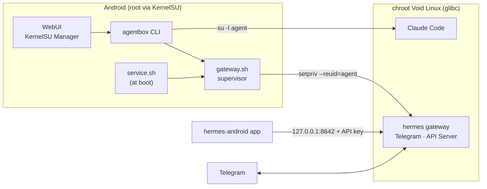

# agentbox

**English** · [Bahasa Indonesia](README.id.md)

**Claude Code and Hermes Agent, running right on your Android phone.**

agentbox is a [KernelSU](https://kernelsu.org) module that sets up a real Linux system (Void Linux, glibc)
inside your phone and runs **[Claude Code](https://claude.com/claude-code)** and
**[Hermes Agent](https://github.com/NousResearch/hermes-agent)** there as a regular, safely confined user.
Set it up once, and your AI agents live in your pocket, start when the phone boots, and are reachable over
Telegram, a terminal, or a chat app.


[](https://github.com/rjial/agentbox/releases)
[](LICENSE)

> **Language note:** the WebUI and CLI messages are currently in Indonesian. Button labels below are quoted
> as they appear on screen, with an English translation.

---

## Why agentbox?

- **No emulation, no proot.** A chroot with KernelSU root: native speed and a real glibc, so the official
  Claude Code and Hermes binaries run as-is, without Termux patches.
- **An always-on assistant.** The Hermes gateway (Telegram and other platforms) runs under its own
  supervisor: it starts at boot, restarts itself with backoff if it crashes, and rotates its logs.
- **Managed from the phone, no laptop needed.** A WebUI in KernelSU Manager covers status, the gateway,
  a terminal for setup wizards, and configuration. Sign in to Claude, install Hermes, set up Telegram, all
  from your phone screen.
- **Secure by default.** The agents never run as root, have no sudo, and secrets never show up in logs or
  process arguments.
- **One CLI for everything.** `agentbox setup`, `doctor`, `shell`, `update`, `backup`, and more. The WebUI
  calls the same CLI, so behavior is always consistent.

## Features

### One-shot, idempotent setup
`agentbox setup` downloads the latest Void rootfs (checksum verified), installs base packages, creates the
`agent` user, then installs Claude Code and Hermes through **their own official installers**. Every
component records when it is done: setup is safe to re-run, and a failed step can be retried on its own.

```
rootfs → base → locale → user → claude → uv → hermes → gateway
```

### WebUI in KernelSU Manager
Four pages with bottom navigation, working fully **offline** (no CDN):

| Page | What it shows |
|---|---|
| **Status** | What is installed or missing, Claude Code & Hermes versions, disk space, the next step |
| **Gateway** | Start/stop/restart the gateway, start at boot, the last 200 log lines |
| **Terminal** | A real terminal (xterm.js) for interactive wizards: Claude sign-in, `hermes setup`, `hermes model`, `gateway setup`, install/reinstall Hermes |
| **Konfigurasi** (Configuration) | Hermes provider & model, masked keys with inline edit forms, credential status checked directly against Anthropic, the API key for the chat app |

The WebUI terminal **opens no network port**. Input and output go through a FIFO and root-owned files, and
only commands from a fixed list can run (there is no free shell).

### One Claude subscription sign-in, shared by both
Have Claude Pro, Max, or Team? Sign in once in Claude Code (`claude auth login`), then a single tap on
**"Pakai login Claude Code"** ("Use Claude Code login") makes Hermes use the same sign-in, which refreshes
itself automatically. No more copying tokens that expire or get truncated.

`agentbox config auth-check` checks the credentials **actually in use** directly against Anthropic (free,
no conversation is created) and catches classic mistakes such as an OAuth token stored in an API key
variable.

### Chat from an Android app
Turn on the Hermes **Gateway API Server** with one button, then connect the
[hermes-android](https://github.com/rusty4444/hermes-android) chat client to `127.0.0.1:8642`. The key is
random (32 bytes), shown only on request, and can be rotated at any time.

### Diagnostics that tell you how to fix things
`agentbox doctor` checks the architecture, rootfs, disk space, mounts, DNS, HTTPS/certificates, locale,
the user, internet access as `agent`, tool versions, credentials, and the gateway. Every check prints
**OK / WARN / FAIL** together with the command that fixes it. `doctor --fix` only applies safe fixes.

## How it works



- The rootfs lives in `/data/adb/agentbox/rootfs`, **outside** the module folder, so it survives module
  updates.
- Your phone's internal storage appears as `/sdcard` inside the chroot, so Claude Code can work on your
  projects directly.

## Security

This project is built on the assumption that AI agents run code, and that your phone holds important data.

- **The agents are never root.** `claude` and `hermes` always run as the `agent` user (fixed uid 8061),
  without sudo and outside the `wheel` group. System packages can only be installed via `agentbox install`.
- **The UID is chosen deliberately.** The default UID 1000 collides with Android's `AID_SYSTEM`, while
  UIDs ≥ 10000 are blocked by netd. The agent uses a range Android does not use, plus the network groups
  the Android kernel requires.
- **Deleting never touches your storage.** `reset` and uninstall must unmount every bind mount and verify
  it through `/proc/mounts` before deleting anything, and they validate paths.
- **Secrets never leak into logs or argv.** API keys are read from stdin or the environment, shown only
  masked (`sk-ant-…a1b2`), and config files are `600`.
- **No unnecessary open ports.** The WebUI terminal opens no port. The Hermes API Server listens on loopback
  only and requires a key. The Hermes web dashboard is intentionally **not** enabled, because on Android
  loopback it has no login and could be taken over by other apps.

## Requirements

- An **arm64** Android phone with **KernelSU** (developed and tested on KernelSU-Next).
- A metamodule for the `system/bin` overlay (for example mountify). Without one, agentbox writes small
  launcher commands into Termux instead.
- About **3 GB** free in `/data`, and an internet connection during setup.
- A Claude account (Pro/Max/Team) or an Anthropic API key for Claude Code. Hermes can use any provider it
  supports.

## Installation

1. **Download the module zip** from [Releases](https://github.com/rjial/agentbox/releases): pick
   `agentbox-vX.Y.Z-release.zip` (or `-debug.zip` for full diagnostic logs). Verify it with the `SHA256SUMS`
   file from the same release.

   Or build it yourself (works on the phone via Termux, or on a PC):
   ```sh
   git clone https://github.com/rjial/agentbox.git
   cd agentbox
   sh tools/build.sh release      # output: dist/agentbox-<version>-release.zip
   ```
2. **Flash** the zip in KernelSU Manager, then reboot.
3. **Set up**, either way:
   - WebUI: KernelSU Manager → agentbox → **Terminal** → *setup (semua komponen)* ("setup, all components"), or
   - Termux: `su -c agentbox setup`
4. **Sign in and configure**:
   - Terminal → *login Claude Code*, tap the link, approve in your browser, and paste the code back.
   - Konfigurasi → *Pakai login Claude Code* ("Use Claude Code login") if Hermes uses Anthropic, or
     *hermes setup* for other providers.
   - Terminal → *gateway setup* for Telegram. The gateway is enabled at boot automatically.

## Everyday use

```sh
claude                      # Claude Code in the chroot, as the agent user
hermes                      # Hermes Agent
agentbox shell              # enter the chroot as agent   (--root for repairs, --safe for rescue)
agentbox doctor             # full diagnostics
agentbox config auth-check  # Anthropic credentials in use, checked against the API
agentbox service status     # gateway status             (start | stop | restart | log | autostart on|off)
agentbox update             # update the rootfs, Claude Code, and Hermes
agentbox backup             # archive /home/agent
```

`claude`, `hermes`, and `agentbox` can be called straight from Termux; when needed they elevate to root
through `su` and then drop back down to the `agent` user. Every command has `--help`.

## Development

```sh
sh tools/build.sh release   # zip without debug logging
sh tools/build.sh debug     # zip with debug logging: logs/debug.log, setup trace, Hermes installer --verbose
```

- Android-side scripts are written in **POSIX sh** and must pass `shellcheck -s sh` with no warnings.
  Scripts inside the chroot may use bash (`shellcheck -s bash`).
- The WebUI has no build step: plain HTML, CSS, and JS, with libraries in `webroot/vendor/` (xterm.js;
  Preact + htm on the Configuration page).
- Architecture notes, design decisions, and verification results live in [`CLAUDE.md`](CLAUDE.md)
  (in Indonesian).

### Versioning and releases

agentbox follows [Semantic Versioning](https://semver.org). The version is written only in `module.prop`
(`version=vMAJOR.MINOR.PATCH`, with `versionCode = MAJOR×10000 + MINOR×100 + PATCH` so KernelSU always
recognizes the newer version). Bump it with:

```sh
sh tools/bump-version.sh patch     # or minor | major | 1.2.0 | 1.3.0-rc.1
git commit -am "Release v0.1.1" && git push
```

Every push to `main` that changes the version runs [GitHub Actions](.github/workflows/release.yml): lint
(shellcheck), version validation, release + debug zip builds, then a **GitHub Release** `vX.Y.Z` with
`SHA256SUMS` and generated release notes. Pre-release versions (e.g. `-rc.1`) are marked as *prerelease*.

### Updates from KernelSU Manager

`module.prop` includes `updateJson`, so KernelSU Manager checks for the latest stable release on its own and
offers the update together with its changelog. Every stable release ships an `update.json` and a
`changelog.md`; pre-releases are never offered as updates. The rootfs, configuration, and data in
`/data/adb/agentbox` are left untouched when the module is updated.

## Status

agentbox is used and tested on one device (arm64, KernelSU-Next). Some parts are still a **prototype**:

- WebUI terminal: latency and the on-screen keyboard depend on the KernelSU Manager WebView on your phone.
- The Configuration page is a Preact pilot; the other pages are still plain JavaScript.
- The hermes-android app is a third-party project and has not been thoroughly tested with agentbox.

Bug reports and pull requests are very welcome.

## Credits

- [Claude Code](https://claude.com/claude-code) by Anthropic. Its binary is **not bundled**; it is always
  downloaded from the official installer during setup.
- [Hermes Agent](https://github.com/NousResearch/hermes-agent) by Nous Research, installed through its
  official installer.
- [Void Linux](https://voidlinux.org), [xterm.js](https://xtermjs.org) (MIT),
  [Preact](https://preactjs.com) (MIT) + [htm](https://github.com/developit/htm) (Apache-2.0).
  Licenses for the bundled libraries are in `webroot/vendor/`.
- [hermes-android](https://github.com/rusty4444/hermes-android) by rusty4444.

## License

[MIT](LICENSE) © 2026 Rizal Abdul Basith. Third-party libraries in `webroot/vendor/` keep their own licenses
(xterm.js MIT, Preact MIT, htm Apache-2.0). Claude Code and Hermes Agent are not part of this repository and
are subject to their authors' licenses and terms.
